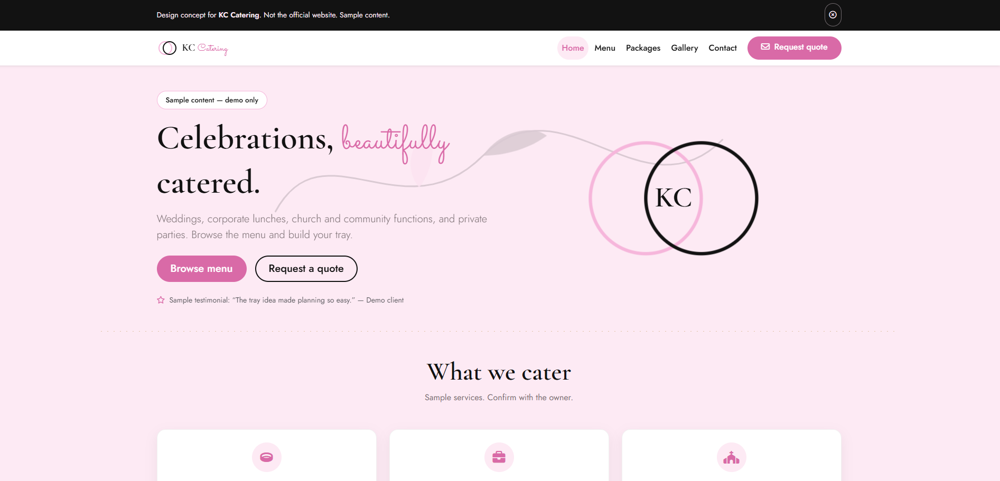
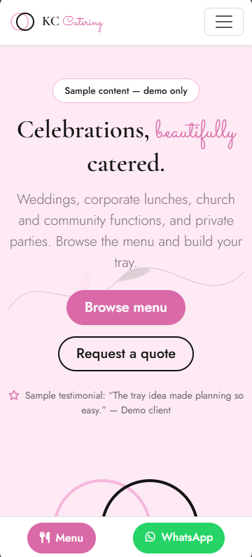

# KC Catering — Design Concept

An elegant, menu-focused catering site that turns a menu browse into a quote request.

**Status:** Design concept — not the official website. Built by **Tesseract Cloud Technologies, Port Moresby**. Live demo: `https://tesseract-cloud-technologies.github.io/kc-catering/`.





---

## 1. Project overview

KC Catering is a catering company whose logo shows a monoline KC inside overlapping pink and black rings with a black brush-stroke bird or leaf flourish. There is no verified public profile, and the business is not connected to Deli KC at Airways Hotel.

The site serves wedding and event planners comparing menus, corporate admins ordering lunch for a meeting, and church or community organisers working to a budget. The concept exists to feel refined and celebratory, make menu planning quick, and capture complete event details in one form — and to give the owner a reviewable blueprint before any production build.

Everything on this site is **sample content** unless explicitly marked otherwise. No statistics, awards, testimonials, dish names, prices, service areas, or minimum numbers have been invented beyond what was supplied in the brief.

---

## 2. Objectives and goals

**Business goals**
- Increase quote requests for weddings, corporate functions, and community events.

**Design goals**
- Feel refined and celebratory without tipping into fussiness.
- Make menu planning quick, including on a phone.
- Capture complete event details in one form so the first reply is useful.

**Suggested success measures for a live version**
- Menu page to tray-add rate.
- Tray to quote submission conversion.
- Quote form completion rate.
- Average dishes added per tray.
- Distribution of event types submitted.

These are suggested measures, not supplied data.

---

## 3. Users and user goals

| Persona | Situation | Goal | How the interface helps |
|---|---|---|---|
| Wedding or event planner | Comparing several caterers; needs a menu they can review with the couple | Browse a full menu and assemble a shortlist | Categorised menu, add-to-tray, quote form that pre-fills the tray |
| Corporate admin | Ordering lunch for a meeting; time-poor | Get a quick per-head sense and send a complete brief | Tray totals multiply per-head price by guest count; quote form captures venue, date, and budget |
| Church or community organiser | Working to a tight budget | See sample per-head costs before enquiring | Per-head prices visible on every dish card; tray total updates live |

**Top three user tasks and target taps/clicks**
1. From menu page to quote submission — **3 taps** (add dish → open tray → send request).
2. From home page to a filtered menu category — **2 taps** (Menu → category chip).
3. From quote page to a sample reference number — **2 taps** (fill event details → submit).

---

## 4. Brand and visual identity

Brand cues came from the brief: a monoline KC inside overlapping pink and black rings, with a brush-stroke flourish. The visual language leans on Blush Pink and Petal for a soft, celebratory mood, with Ink Black for structure and Rose Deep for interaction states. Champagne is reserved for thin rules only.

**Colour palette**

| Swatch | Name | Hex | Role | Contrast note |
|---|---|---|---|---|
|  | Blush Pink | #F6B6DB | Rings, accents, chips | AA with Ink Black text |
|  | Petal | #FDEAF4 | Alternate section background | AA with Ink Black text |
|  | Ink Black | #121212 | Text, rings, footer | AA against Petal and White |
|  | White | #FFFFFF | Card base, form fields | AA with Ink Black text |
|  | Rose Deep | #D96AA7 | Links, hover, buttons | AA with White text |
|  | Champagne | #C9A66B | Thin rules only | Decorative; not used for text |

**Typography**

| Font | Weights | Where used | Why |
|---|---|---|---|
| Sacramento | 400 | Script accents, small flourishes | Matches the rounded script feel of the catering wordmark |
| Cormorant Garamond | 400, 500, 600, italic | Headings and pull quotes | Elegant serif that carries the celebratory tone without feeling heavy |
| Jost | 300, 400, 500, 600 | Body, UI, buttons, labels | Neutral geometric sans that keeps dense menu and form UI legible |

**Signature shapes and motifs**
- Two overlapping rings, one Blush Pink and one Ink Black, forming the KC monogram motif.
- A black brush-stroke bird or leaf flourish drawn as SVG across the hero.
- Monoline cutlery and cloche illustrations used sparingly as icons.
- Scalloped card edges and circular image masks.
- A delicate dotted-line separator between sections.

**Imagery and icons**
No stock photography is used. Dish and event imagery is represented by CSS gradient cards with clearly marked image slots. Font Awesome Free 6.5.2 provides icons: utensils, martini glass, plate wheat, box, check.

**Tone of voice**
Refined and warm. Plain PNG English. "Celebrations, beautifully catered." rather than "unforgettable culinary journeys". Sample content is labelled as sample wherever it appears.

---

## 5. UI design system

**Grid and spacing**
Bootstrap 5.3.3 twelve-column grid. Section rhythm uses `py-5` with `clamp()` on display type. Cards share a 16px radius and a single soft shadow token.

**Breakpoints**
Mobile-first, tested at 320, 360, 390, 768, 1024, 1440 and 1920px. Category chips scroll inside their own overflow container. The tray becomes a bottom sheet on phones. The sticky bottom bar appears only on phones.

**Key components and states**

| Component | States |
|---|---|
| Primary button (`btn-rose`) | Default, hover (lift + rose shadow), focus-visible, active, disabled |
| Outline button (`btn-outline-ink`) | Default, hover, focus-visible |
| Category chip | Default, hover, active |
| Dish card | Default, hover (lift), added-to-tray |
| Tray offcanvas | Closed, open, empty, populated |
| Quantity control | Default, increase, decrease, remove |
| Quote form input | Default, focus (rose ring), invalid, valid |
| Success state | Hidden, shown with sample reference |

**Animations and reduced-motion fallbacks**

| Animation | Purpose | Reduced-motion fallback |
|---|---|---|
| Flourish draws itself (stroke-dashoffset) | Adds elegance to the hero | Disabled — flourish shown fully drawn |
| Rings slide into the monogram | Nods to the logo construction | Disabled — rings static |
| Staggered menu item reveal | Makes menu browsing feel considered | Disabled — items visible |
| Ink underline grows on link hover | Confirms interactivity | Transition duration reduced |
| Tray slides up from the bottom | Keeps the tray close without covering the menu | Instant open |

All motion is disabled under `prefers-reduced-motion: reduce`.

**Accessibility decisions**
- Skip link on every page.
- One `<h1>` per page.
- Visible `:focus-visible` ring in Rose Deep.
- ARIA labels on all icon buttons, including the tray toggle and remove buttons.
- Tray uses Bootstrap offcanvas semantics with a labelled title.
- Quote form is front-end only and clearly states "This is a demo, no real quote has been requested."
- Minimum 44px tap targets.
- AA contrast for body text; Champagne not used for text.
- Tray selections are stored in `sessionStorage` only for the current visit and are never sent anywhere.

---

## 6. Page map and user flows

**Sitemap**

```mermaid
flowchart TD
    Home[index.html] --> Menu[menu.html]
    Home --> Packages[packages.html]
    Home --> Gallery[gallery.html]
    Home --> Quote[quote.html]
    Home --> Contact[contact.html]
    Menu --> Tray[Tray offcanvas]
    Tray --> Quote
    Packages --> Quote